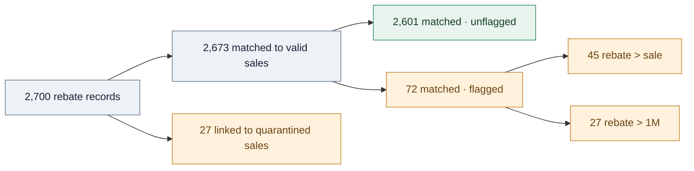
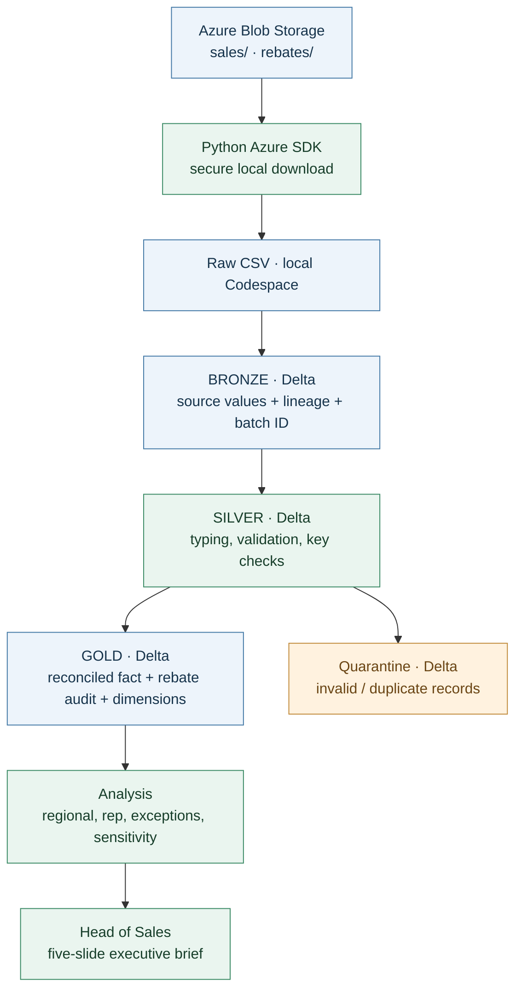

<div align="center">

# The Information Lab Ireland | Data Engineering Technical Challenge

### Retail Sales & Rebates Reconciliation
**An End-to-End PySpark & Delta Lake Proof of Concept**

**The Information Lab Ireland · Data Engineering Technical Challenge · November 2026**

   

**27,000 sales · 2,700 rebates · 36 source files · 5 currencies**

*An engineering POC that makes financial exceptions visible instead of silently turning questionable data into confident-looking dashboards.*

</div>

---

## Executive readout

> **The central finding:** Just **135 high-value sales (0.50% of valid sales)** account for virtually all source-basis gross sales in each currency. The original revenue view is mathematically reconciled but **not yet business-certified**. A separately labeled sensitivity scenario shows how dramatically the picture changes when these transactions and associated rebates are set aside.

| Data coverage | Result | What it tells us |
|:--|--:|:--|
| Source files ingested | **36** | 27 sales files and 9 rebate files |
| Sales records received | **27,000** | 26,865 passed current Silver rules; 135 quarantined |
| Rebate records received | **2,700** | All accounted for in the Gold rebate audit |
| Rebates matched to valid sales | **2,673 (99.0%)** | Matching uses `Sale Transaction ID` |
| Rebates linked to quarantined sales | **27 (1.0%)** | No completely unknown sale references |
| Matched rebates flagged for review | **72** | 45 exceed their sale; 27 exceed 1M; no overlap |
| Large valid sales flagged | **135** | Amount above 1M in transaction currency |

### Rebate reconciliation — complete record-level accounting



**Control:** `2,601 + 72 + 27 = 2,700`. The 27 unmatched rebates are not missing from the source: they reference sales deliberately retained in the negative-quantity quarantine. Matching status is distinct from financial validity.

## What changed when we challenged the source figures?

The source values include a small cluster of extreme sales. The analysis compares two **different, explicitly defined** views:

- **Source-basis:** valid Silver sales less *all* matched rebates, including flagged values.
- **Sensitivity scenario:** sales with amounts **≤ 1,000,000** in their own currency, less **unflagged** rebates attached to those retained sales. Rebates attached to excluded sales are also removed. This is **not** an approved accounting adjustment.

### EUR example — scale of the distortion

| EUR measure | Source-basis | Sensitivity scenario |
|:--|--:|--:|
| Gross sales | **€5,049,451,333,717.80** | **€1,333,717.80** |
| Net revenue | **€4,826,691,302,177.11** | **€1,304,138.45** |
| Sales transactions | **13,383** | **13,324** |

The **59 excluded EUR sales** account for €5,049,450,000,000 of the source-basis EUR gross amount. This is a sensitivity result, **not evidence that those transactions are invalid**.

### Regional net revenue — sensitivity scenario

The following values are **within-currency comparisons**, not currency-converted totals. The regions reflect **customer region**, not sales representative territory.

| Currency | EMEA | North America | Higher scenario net |
|:--|--:|--:|:--|
| EUR | 815,965.88 | 488,172.57 | EMEA |
| USD | 203,470.58 | 127,488.26 | EMEA |
| GBP | 201,970.45 | 123,960.82 | EMEA |
| CAD | 203,281.86 | 124,117.39 | EMEA |
| MXN | 193,145.19 | 117,170.78 | EMEA |

**Visual comparison — scenario net revenue, normalized within each currency**  
*Each bar pair uses its own currency scale; bar lengths must not be compared across currency rows.*

| Currency | EMEA | North America |
|:--|:--|:--|
| EUR | `████████████████████` 816k | `████████████` 488k |
| USD | `████████████████████` 203k | `█████████████` 127k |
| GBP | `████████████████████` 202k | `████████████` 124k |
| CAD | `████████████████████` 203k | `████████████` 124k |
| MXN | `████████████████████` 193k | `████████████` 117k |

**Interpretation:** EMEA leads North America in the exploratory scenario in every reported currency. This does **not** establish higher profitability, nor does it validate the exclusion threshold. Currency totals must never be combined without an agreed FX methodology.

### Exceptions that require a business decision

| Exception | Records | Treatment in this POC |
|:--|--:|:--|
| Negative unit quantity | **135 sales** | Quarantined; may represent returns or adjustments |
| Rebate linked to quarantined sale | **27 rebates** | Preserved in audit; not deducted from valid-sale fact |
| Rebate exceeds its sale amount | **45 rebates** | Flagged for review, not deleted |
| Rebate amount above 1M | **27 rebates** | Diagnostic flag, not a business rule |
| Valid sale amount above 1M | **135 sales** | Retained in source-basis; excluded only in sensitivity scenario |

The 135 negative-quantity sales occur **five per sales file across 27 files**. This systematic pattern merits investigation, but does not establish a root cause. The 135 negative-quantity records and the 135 high-value valid sales are **different cohorts**.

---

## Solution architecture



| Layer | Design choice | Benefit |
|:--|:--|:--|
| **Ingestion** | Azure SDK downloads files before Spark processing | Matches the challenge's two-step environment |
| **Bronze** | Raw fields as strings, file lineage, ingestion timestamp and batch ID | Traceability and replayable source snapshot |
| **Silver** | Standardized names/types, validation and quarantine | Exceptions stay observable; valid facts have a consistent schema |
| **Gold** | Sales-grain fact, rebate-level audit, region and rep dimensions | Avoids many-to-one join multiplication; supports business reporting |
| **Analysis** | Currency-separated KPIs and explicit sensitivity scenarios | Prevents misleading cross-currency aggregation |

### Gold data products

| Table | Grain | Primary use |
|:--|:--|:--|
| `fact_sales_reconciled` | One row per valid sale | Gross sales, matched rebates, source-basis and provisional net |
| `fact_rebate_audit` | One row per rebate transaction | Match status, outlier flags, unmatched exposure |
| `dim_region` | Distinct customer region | Regional reporting |
| `dim_sales_rep` | Sales representative ID | Representative reporting; name inconsistency indicator |

**Important:** This is a portable **PySpark + Delta Lake POC in GitHub Codespaces**, not a deployed Microsoft Fabric workload. A Fabric Lakehouse, orchestration, governance and semantic model are proposed production extensions.

---

## Reproduce the pipeline

### Environment

Use the challenge template's GitHub Codespaces dev container (Python 3.10, PySpark 3.5.0, Delta Lake 3.0.0). From the repository root:

```bash
python --version
java -version
python -m pip check
```

### Secure data access

Set the SAS token as a **Codespaces secret** named `AZURE_STORAGE_SAS_TOKEN`, or supply it temporarily in a terminal:

```bash
read -rs AZURE_STORAGE_SAS_TOKEN
export AZURE_STORAGE_SAS_TOKEN
```

Do **not** commit the SAS token, `.env` files, raw client data, Delta files or generated analytical outputs. The source container requires authorized access.

### Run in order

```bash
python src/ingest.py                 # Azure Blob -> local CSV
python -m src.bronze                # CSV -> Bronze Delta
python -m src.silver                # Validated Silver + quarantine
python -m src.gold                  # Reconciled Gold tables
python -m src.analysis              # Regional, rep and exception reports
python -m src.outlier_analysis      # Outlier sensitivity comparison
python -m pytest tests/ -v         # Automated checks
```

Generated data lives under `src/data/` and `outputs/analysis/` and is excluded from version control. Spark writes CSV reports as `part-*.csv` inside named output folders. Run commands from the repository root. If an Azure token has expired, obtain a new one through the challenge organizer; never hard-code it.

### Repository guide

```text
.devcontainer/             Codespaces environment
src/
  ingest.py               Azure download
  spark_session.py        Spark / Delta configuration
  bronze.py               Source snapshots and lineage
  silver.py               Validation and quarantine
  gold.py                 Reconciliation and dimensional tables
  analysis.py             Business reporting
  outlier_analysis.py     Sensitivity analysis
  data/                   Local, ignored
outputs/analysis/          Generated reports, ignored
tests/                     Automated financial controls
presentation/              Executive presentation
README.md                  This case study
requirements.txt           Pinned dependencies
```

> **Verification note:** The counts and outputs documented here come from the executed Codespaces results captured during the challenge. Run the included tests in your own environment before claiming a green test suite; no CI status is asserted here.

---

## Financial logic & controls

### Transaction grain

`Sale Transaction ID` is the observed relationship key. Gold checks sale ID uniqueness before joining and aggregates matched rebates to the sale grain to prevent inflated sales totals. `Rebate Transaction ID` identifies rebate events. The rebate audit retains unmatched rows rather than dropping them through an inner join.

### Measures

```text
Source-basis net revenue = valid sales amount - all matched rebates
Provisional net revenue  = valid sales amount - unflagged matched rebates
Sensitivity scenario     = retained sales (amount <= 1M)
                           - unflagged rebates on those retained sales
```

Financial equations are checked by currency using decimal values. **Source-basis** is an accounting-style arithmetic reconciliation of the current inputs, not a certification of their accuracy. **Provisional** and **sensitivity** views are analytical constructs, not approved financial statements.

### Business assumptions requiring confirmation

1. Negative quantities might represent returns; they are not automatically converted into negative revenue.
2. Positive rebate amounts are treated as deductions; reversal/adjustment conventions need Finance approval.
3. The 1M threshold is exploratory and applied separately to each transaction's original currency; it is **not** currency-normalized.
4. A rebate exceeding its linked sale is a review flag, not definitive evidence of an error.
5. Reporting uses `customer_region`; sales-rep territory can be analyzed separately.
6. No currency conversion, FX rate table, margin or cost model is provided.
7. The current Bronze/Silver/Gold implementation uses full-refresh overwrites, not production incremental processing.

### Controls and known limitations

- **Passed in observed runs:** 27,000 = 26,865 + 135 sales; 2,700 = 2,601 + 72 + 27 rebates; no unknown rebate sale references; no matched currency mismatches; Gold sale count preserved at 26,865.
- **Financial control:** per-currency gross sales − matched rebates = source-basis net revenue.
- **To strengthen for production:** synthetic unit tests, automated regression checks, ETag-based file manifests, incremental ingestion, schema drift management, deterministic dimension handling, monitoring and incident alerts.
- **Privacy:** customer source records and generated lakehouse data are intentionally excluded from Git.

---

## Recommendations to the Head of Sales

| Horizon | Action | Outcome |
|:--|:--|:--|
| **Now** | Have Finance validate the 135 extreme sales, 72 flagged rebates and negative-quantity transactions | Agree which amounts are genuine and how returns should be recognized |
| **Next** | Define approved rebate policies, exception ownership, reporting currency and certified net revenue | One trusted commercial metric with documented exclusions |
| **Then** | Move the POC to Microsoft Fabric with incremental ingestion, scheduled pipelines, monitoring and a governed semantic model | Repeatable, auditable reporting for regional and rep performance |

### Deliverable

See the five-slide executive brief in [`presentation/`](presentation/) for the Head of Sales narrative, financial findings, architecture and roadmap.

---

## 👨‍💻 Creator

### Dinesh Barri

#### 📬 Contact Information

- **📧 Email**: [dineshbarri1997@gmail.com](mailto:dineshbarri1997@gmail.com)
- [](https://github.com/dineshbarri)
- [](https://www.linkedin.com/in/dinesh-barri-7654b010b)
